

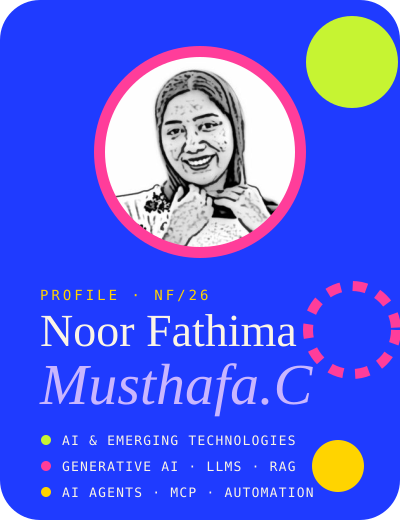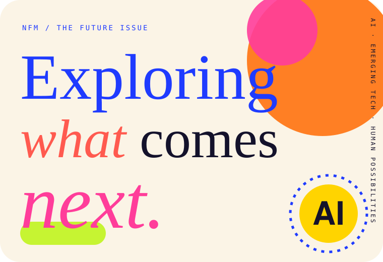

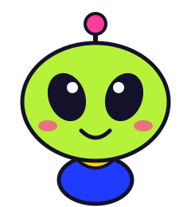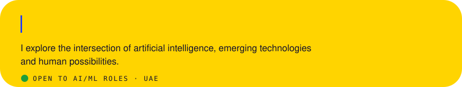

   

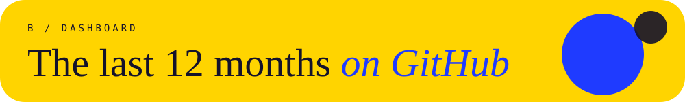

 

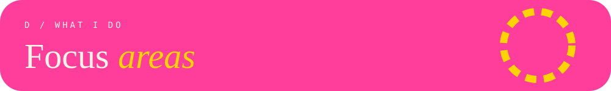

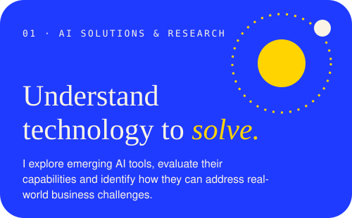 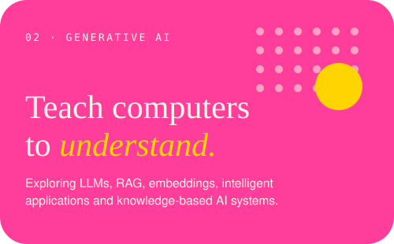
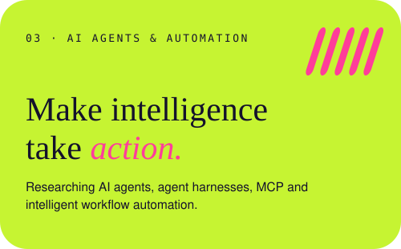 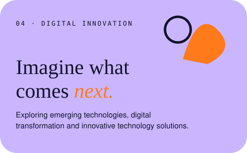

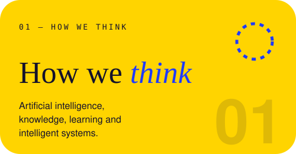 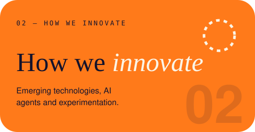
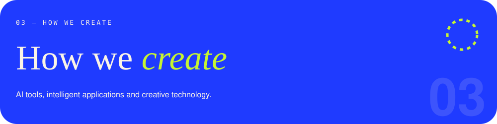
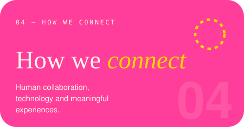 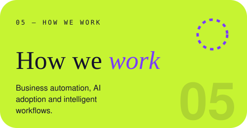

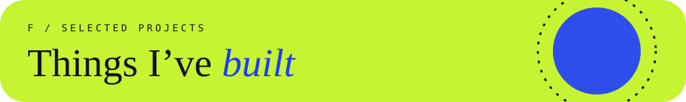

<a href="https://github.com/noorfathimamusthafac/AI-DEVELOPMENT-AGENT">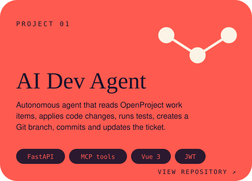</a> <a href="https://github.com/noorfathimamusthafac/AGENT-HARNESS">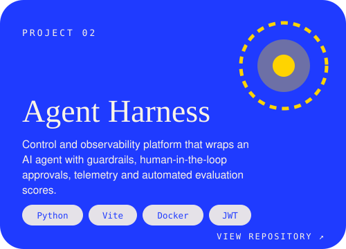</a>
<a href="https://github.com/noorfathimamusthafac/MCP-POWERED-SMART-NOTES-SERVER">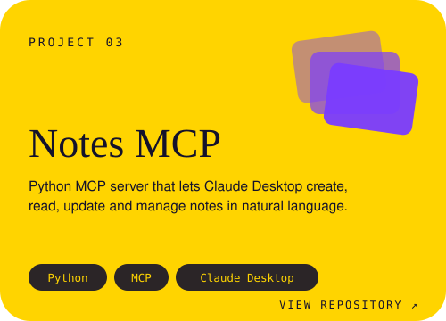</a> <a href="https://github.com/noorfathimamusthafac/TALENTGRAPH-AI">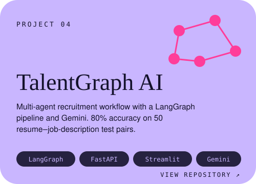</a>

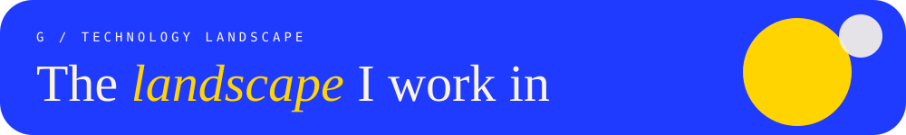

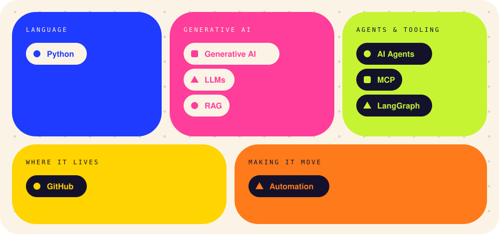

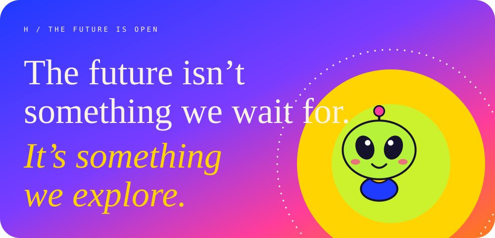

  

